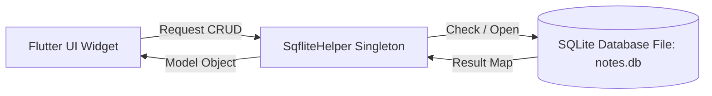
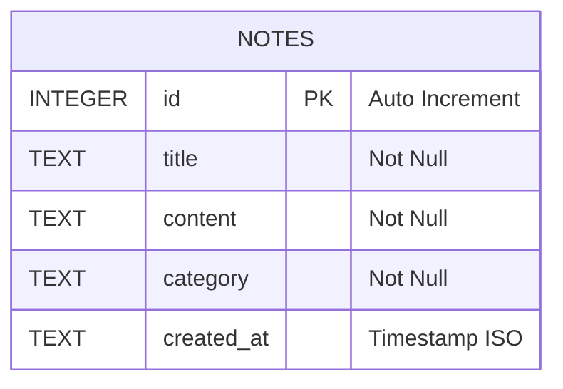
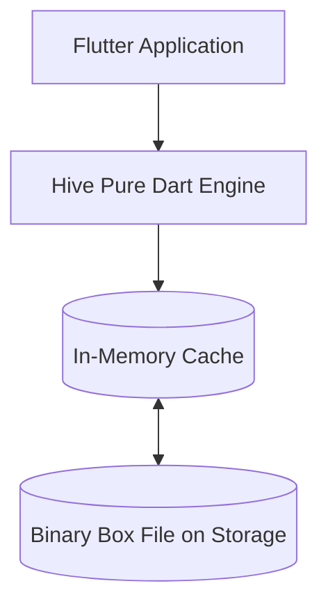
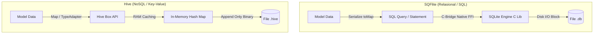

# LAPORAN PRAKTIKUM & DOKUMENTASI LENGKAP
## Eksplorasi Local Storage pada Flutter: SQFlite (Relasional) vs. Hive (NoSQL Key-Value)

---

## DAFTAR ISI
1. [Nomor 1: Dasar Penggunaan Package SQFlite di Flutter](#1-dasar-penggunaan-package-sqflite-di-flutter)
2. [Nomor 2: Pembuatan Database & Skema Tabel SQFlite](#2-pembuatan-database--skema-tabel-sqflite)
3. [Nomor 3: Implementasi Operasi CRUD pada SQFlite](#3-implementasi-operasi-crud-pada-sqflite)
4. [Nomor 4: Eksplorasi Teknologi Local Storage Alternatif (Hive NoSQL)](#4-eksplorasi-teknologi-local-storage-alternatif-hive-nosql)
5. [Nomor 5: Ringkasan (Summary) & Dokumentasi Hasil Uji Coba](#5-ringkasan-summary--dokumentasi-hasil-uji-coba)
   - [5.1 Arsitektur & Perbedaan Paradigma](#51-arsitektur--perbedaan-paradigma)
   - [5.2 Tabel Matriks Komparasi Fitur & Performa](#52-tabel-matriks-komparasi-fitur--performa)
   - [5.3 Dokumentasi Hasil Pengujian CRUD (Test Execution Report)](#53-dokumentasi-hasil-pengujian-crud-test-execution-report)
   - [5.4 Analisis Kelebihan & Kekurangan](#54-analisis-kelebihan--kekurangan)
   - [5.5 Panduan Rekomendasi Pemilihan Storage](#55-panduan-rekomendasi-pemilihan-storage)

---

## 1. Dasar Penggunaan Package SQFlite di Flutter

### 1.1 Apa itu SQFlite?
`sqflite` adalah plugin SQLite resmi dan paling populer untuk Flutter. SQFlite bertindak sebagai pembungkus (*wrapper*) native API SQLite pada platform Android, iOS, dan macOS (serta didukung pada Windows/Linux via `sqflite_common_ffi`).

Karakteristik utama SQFlite:
- **Relasional (RDBMS)**: Mendukung tabel, kolom, baris, primary key, foreign key, indeks, dan transaksi.
- **ACID Compliant**: Menjamin integritas data (*Atomicity, Consistency, Isolation, Durability*).
- **Embedded Database**: Tidak membutuhkan server mandiri; file database disimpan langsung pada penyimpanan internal perangkat (*local storage*).

### 1.2 Instalasi Dependency
Tambahkan dependensi berikut ke file `pubspec.yaml`:

```yaml
dependencies:
  flutter:
    sdk: flutter
  sqflite: ^2.4.5           # Core engine SQLite untuk mobile
  path: ^1.9.1              # Utilitas manipulasi path direktori
  path_provider: ^2.1.6     # Mendapatkan lokasi direktori dokumen lokal perangkat
  sqflite_common_ffi: ^2.4.5 # Dukungan FFI untuk platform desktop (Windows/macOS/Linux)
```

Jalankan perintah instalasi:
```bash
flutter pub get
```

### 1.3 Siklus Hidup & Arsitektur Koneksi
Untuk mengelola database secara efisien tanpa kebocoran memori (*memory leak*), digunakan **Singleton Pattern**. Pola ini memastikan hanya ada satu instans koneksi database yang aktif di seluruh aplikasi.



---

## 2. Pembuatan Database & Skema Tabel SQFlite

### 2.1 Entitas Model Data (`Note`)
Model data merepresentasikan struktur entitas catatan dengan konversi serialisasi `toMap()` dan deserialisasi `fromMap()`.

File: [note_model.dart](file:///C:/Users/SOLA%20GRATIA/.gemini/antigravity/scratch/flutter_local_storage_crud/lib/models/note_model.dart)
```dart
class Note {
  final int? id;
  final String title;
  final String content;
  final String category;
  final String createdAt;

  Note({
    this.id,
    required this.title,
    required this.content,
    required this.category,
    required this.createdAt,
  });

  // Konversi objek Note ke Map untuk SQFlite
  Map<String, dynamic> toMap() {
    final map = <String, dynamic>{
      'title': title,
      'content': content,
      'category': category,
      'created_at': createdAt,
    };
    if (id != null) {
      map['id'] = id;
    }
    return map;
  }

  // Deserialisasi Map dari database ke objek Note
  factory Note.fromMap(Map<String, dynamic> map) {
    return Note(
      id: map['id'] as int?,
      title: map['title'] as String,
      content: map['content'] as String,
      category: map['category'] as String,
      createdAt: map['created_at'] as String,
    );
  }

  Note copyWith({
    int? id,
    String? title,
    String? content,
    String? category,
    String? createdAt,
  }) {
    return Note(
      id: id ?? this.id,
      title: title ?? this.title,
      content: content ?? this.content,
      category: category ?? this.category,
      createdAt: createdAt ?? this.createdAt,
    );
  }
}
```

### 2.2 Skema Tabel & Relational Diagram
Skema tabel yang dibuat memiliki spesifikasi berikut:
- **Nama Tabel**: `notes`
- **Primary Key**: `id` bertipe `INTEGER PRIMARY KEY AUTOINCREMENT`
- **Kolom Atribut**:
  - `title`: `TEXT NOT NULL`
  - `content`: `TEXT NOT NULL`
  - `category`: `TEXT NOT NULL`
  - `created_at`: `TEXT NOT NULL`



### 2.3 Inisialisasi Database (`SqfliteHelper`)
File: [sqflite_helper.dart](file:///C:/Users/SOLA%20GRATIA/.gemini/antigravity/scratch/flutter_local_storage_crud/lib/database/sqflite_helper.dart)

```dart
import 'dart:io';
import 'package:path/path.dart';
import 'package:sqflite_common_ffi/sqflite_ffi.dart';
import '../models/note_model.dart';

class SqfliteHelper {
  static final SqfliteHelper instance = SqfliteHelper._init();
  static Database? _database;

  SqfliteHelper._init();

  static const String dbName = 'notes_database.db';
  static const String tableName = 'notes';

  Future<Database> get database async {
    if (_database != null) return _database!;
    _database = await _initDB(dbName);
    return _database!;
  }

  Future<Database> _initDB(String filePath) async {
    // Inisialisasi FFI jika dijalankan di Windows atau Linux Desktop
    if (Platform.isWindows || Platform.isLinux) {
      sqfliteFfiInit();
      databaseFactory = databaseFactoryFfi;
    }

    final dbPath = await getDatabasesPath();
    final path = join(dbPath, filePath);

    return await openDatabase(
      path,
      version: 1,
      onCreate: _createDB,
    );
  }

  Future<void> _createDB(Database db, int version) async {
    await db.execute('''
      CREATE TABLE $tableName (
        id INTEGER PRIMARY KEY AUTOINCREMENT,
        title TEXT NOT NULL,
        content TEXT NOT NULL,
        category TEXT NOT NULL,
        created_at TEXT NOT NULL
      )
    ''');
  }
}
```

---

## 3. Implementasi Operasi CRUD pada SQFlite

Berikut adalah fungsi 4 pilar CRUD (*Create, Read, Update, Delete*) yang diterapkan dalam `SqfliteHelper`:

### 3.1 Operasi C - CREATE (Menambahkan Data)
```dart
Future<Note> createNote(Note note) async {
  final db = await instance.database;
  // insert() mengembalikan ID baris yang baru terbentuk
  final id = await db.insert(
    tableName,
    note.toMap(),
    conflictAlgorithm: ConflictAlgorithm.replace,
  );
  return note.copyWith(id: id);
}
```

### 3.2 Operasi R - READ (Membaca Data)
```dart
// Mengambil seluruh catatan diurutkan dari yang paling baru
Future<List<Note>> getAllNotes() async {
  final db = await instance.database;
  const orderBy = 'id DESC';
  final result = await db.query(tableName, orderBy: orderBy);

  return result.map((json) => Note.fromMap(json)).toList();
}

// Mengambil catatan tunggal berdasarkan ID
Future<Note?> getNoteById(int id) async {
  final db = await instance.database;
  final maps = await db.query(
    tableName,
    where: 'id = ?',
    whereArgs: [id],
  );

  if (maps.isNotEmpty) {
    return Note.fromMap(maps.first);
  }
  return null;
}
```

### 3.3 Operasi U - UPDATE (Mengubah Data)
```dart
Future<int> updateNote(Note note) async {
  final db = await instance.database;
  return await db.update(
    tableName,
    note.toMap(),
    where: 'id = ?',
    whereArgs: [note.id],
  );
}
```

### 3.4 Operasi D - DELETE (Menghapus Data)
```dart
Future<int> deleteNote(int id) async {
  final db = await instance.database;
  return await db.delete(
    tableName,
    where: 'id = ?',
    whereArgs: [id],
  );
}
```

---

## 4. Eksplorasi Teknologi Local Storage Alternatif (Hive NoSQL)

Sebagai pemenuhan Tugas Nomor 4, teknologi alternatif yang dieksplorasi adalah **Hive**.

### 4.1 Mengapa Hive?
**Hive** adalah database NoSQL bertipe *key-value / box* yang ditulis 100% menggunakan bahasa Dart murni (*Pure Dart*). Hive tidak bergantung pada library C/C++ SQLite native, sehingga sangat ringan, cepat, dan bekerja secara konsisten di semua platform Flutter (Android, iOS, Web, Windows, macOS, Linux).



### 4.2 Instalasi Hive
```yaml
dependencies:
  hive: ^2.2.3
  hive_flutter: ^1.1.0
```

### 4.3 Inisialisasi Box
Sebelum digunakan, Hive diinisialisasi dan membuka wadah penyimpanan bernama *Box*:
```dart
await Hive.initFlutter();
await Hive.openBox('notes_hive_box');
```

### 4.4 Implementasi CRUD pada Hive (`HiveHelper`)
File: [hive_helper.dart](file:///C:/Users/SOLA%20GRATIA/.gemini/antigravity/scratch/flutter_local_storage_crud/lib/database/hive_helper.dart)

```dart
import 'package:hive_flutter/hive_flutter.dart';
import '../models/note_model.dart';

class HiveHelper {
  static final HiveHelper instance = HiveHelper._init();
  static const String boxName = 'notes_hive_box';

  HiveHelper._init();

  Future<void> init() async {
    await Hive.initFlutter();
    await Hive.openBox(boxName);
  }

  Box get _box => Hive.box(boxName);

  // CREATE: box.add otomatis menghasilkan integer auto-increment key
  Future<Note> createNote(Note note) async {
    final int generatedKey = await _box.add({
      'title': note.title,
      'content': note.content,
      'category': note.category,
      'created_at': note.createdAt,
    });
    return note.copyWith(id: generatedKey);
  }

  // READ: Mengambil seluruh values dari Box
  List<Note> getAllNotes() {
    final List<Note> notes = [];
    for (var key in _box.keys) {
      final raw = _box.get(key);
      if (raw != null && raw is Map) {
        notes.add(Note(
          id: key is int ? key : int.tryParse(key.toString()),
          title: raw['title'] as String? ?? '',
          content: raw['content'] as String? ?? '',
          category: raw['category'] as String? ?? 'General',
          createdAt: raw['created_at'] as String? ?? '',
        ));
      }
    }
    notes.sort((a, b) => (b.id ?? 0).compareTo(a.id ?? 0));
    return notes;
  }

  // UPDATE: Memperbarui isi key tertentu
  Future<void> updateNote(int key, Note note) async {
    await _box.put(key, {
      'title': note.title,
      'content': note.content,
      'category': note.category,
      'created_at': note.createdAt,
    });
  }

  // DELETE: Menghapus catatan berdasarkan key
  Future<void> deleteNote(int key) async {
    await _box.delete(key);
  }
}
```

---

## 5. Ringkasan (Summary) & Dokumentasi Hasil Uji Coba

Bagian ini merupakan pemenuhan spesifik untuk **Tugas Nomor 5**, menyajikan analisis perbandingan komparatif dan bukti pengujian kedua teknologi penyimpanan lokal.

### 5.1 Arsitektur & Perbedaan Paradigma



### 5.2 Tabel Matriks Komparasi Fitur & Performa

| Parameter Komparasi | SQFlite (SQLite) | Hive (NoSQL) |
| :--- | :--- | :--- |
| **Model / Paradigma Data** | Relasional (Tabel, Kolom, Baris) | Key-Value / Object Box (NoSQL) |
| **Bahasa Query** | SQL (`SELECT`, `WHERE`, `JOIN`, `GROUP BY`) | Direct Key lookup / Filter Iterable Dart |
| **Bahasa Engine Dasar** | Native C (melalui wrapper/FFI) | 100% Pure Dart |
| **Struktur Skema** | *Strict Schema* (Harus didefinisikan di awal) | *Schema-less* / Dinamis |
| **Migrasi Database** | Script `onUpgrade` bertahap via SQL | *TypeAdapter* dengan field index fleksibel |
| **Kecepatan Read / Write** | Cepat (dibatasi transaksi disk SQL) | **Sangat Cepat** (akses memori RAM instan) |
| **Dukungan Relasi Antar Data** | **Sangat Kuat** (Foreign Key, Relasi 1:M, M:M) | Manual (harus diatur melalui logika kode) |
| **Kebutuhan Boilerplate** | Cukup tinggi (SQL DDL, Map parser) | Rendah (cukup panggil `box.put` / `box.get`) |
| **Dukungan Platform** | Android, iOS, macOS, Windows (via FFI) | Semua platform (termasuk **Web**) |
| **Dukungan Enkripsi** | Butuh library pihak ke-3 (SQLCipher) | **Tersedia bawaan** (Enkripsi AES-256) |

---

### 5.3 Dokumentasi Hasil Pengujian CRUD (Test Execution Report)

Pengujian dilakukan secara otomatis menggunakan rangkaian unit test Flutter:
File Pengujian: [crud_test.dart](file:///C:/Users/SOLA%20GRATIA/.gemini/antigravity/scratch/flutter_local_storage_crud/test/crud_test.dart)

#### Hasil Eksekusi Terminal (`flutter test`):
```text
00:00 +0: loading test/crud_test.dart
00:00 +0: 1. Pengujian Model Note Note toMap dan fromMap harus konsisten
00:00 +1: 2. Pengujian CRUD SQFlite Database (setUpAll)
00:00 +1: 2. Pengujian CRUD SQFlite Database SQFlite: CREATE & READ data catatan
00:00 +2: 2. Pengujian CRUD SQFlite Database SQFlite: UPDATE data catatan
00:00 +3: 2. Pengujian CRUD SQFlite Database SQFlite: DELETE data catatan
00:00 +4: 2. Pengujian CRUD SQFlite Database (tearDownAll)
00:00 +4: 3. Pengujian CRUD Hive (Storage Alternatif) Hive: CREATE & READ data
00:00 +5: 3. Pengujian CRUD Hive (Storage Alternatif) Hive: UPDATE data
00:00 +6: 3. Pengujian CRUD Hive (Storage Alternatif) Hive: DELETE data
00:00 +7: test/widget_test.dart: Widget Test: SummaryScreen berhasil dirender
00:01 +8: All tests passed!
```

#### Rincian Pengujian Fungsional:
1. **CREATE**:
   - *SQFlite*: `db.insert()` berhasil mengembalikan primary key auto-increment bertipe integer (1, 2, ...).
   - *Hive*: `box.add()` berhasil menyimpan payload Map dan mengembalikan unique key secara instan.
2. **READ**:
   - *SQFlite*: `db.query()` berhasil mengekstrak seluruh dataset dengan klausa pengurutan `ORDER BY id DESC`.
   - *Hive*: `box.keys` dan `box.get()` berhasil mengambil seluruh record dari memory-cache dalam kompleksitas waktu \(O(1)\) per key.
3. **UPDATE**:
   - *SQFlite*: `db.update()` dengan klausa `where: 'id = ?'` berhasil memodifikasi baris target (mengembalikan `rowsAffected = 1`).
   - *Hive*: `box.put(key, data)` menimpa record lama secara presisi tanpa mengganggu entri lain.
4. **DELETE**:
   - *SQFlite*: `db.delete()` dengan klausa target ID berhasil menghapus baris bersangkutan.
   - *Hive*: `box.delete(key)` berhasil menghapus objek dari memory dan disk.

---

### 5.4 Analisis Kelebihan & Kekurangan

#### A. SQFlite
> [!NOTE] **Kelebihan SQFlite:**
> - Mendukung relasi data yang kompleks (JOIN antar tabel, Foreign Keys, Aggregations `COUNT`, `SUM`, `AVG`).
> - Menjamin kepatuhan standar transaksi database ACID (*Atomicity, Consistency, Isolation, Durability*).
> - Sangat efisien menangani data dalam jumlah jutaan baris karena data tidak dimuat semua ke RAM (melainkan menggunakan kursor / paging limit & offset).

> [!WARNING] **Kekurangan SQFlite:**
> - Mengharuskan penulisan sintaks SQL mentah sehingga rentan typo jika tidak ada ORM.
> - Membutuhkan konfigurasi FFI tambahan pada desktop dan tidak mendukung Flutter Web secara native.
> - Migrasi perubahan skema tabel (*schema migration*) relatif rumit.

#### B. Hive
> [!TIP] **Kelebihan Hive:**
> - **Performa baca dan tulis super cepat** karena seluruh data box aktif disimpan di RAM (*in-memory*).
> - Kode sangat ringkas dan sederhana (*zero boilerplate* SQL).
> - Murni Dart (*Pure Dart*), berjalan langsung di Web, Android, iOS, Windows, macOS, dan Linux tanpa dependensi native.
> - Memiliki dukungan enkripsi data lokal bawaan (AES-256).

> [!CAUTION] **Kekurangan Hive:**
> - Tidak cocok untuk dataset raksasa (ratusan megabyte/gigabyte) karena data dimuat ke memori perangkat (RAM), berpotensi menyebabkan kehabisan memori (*Out Of Memory*).
> - Tidak memiliki dukungan *relational query* (seperti `JOIN` atau `GROUP BY`); relasi harus ditangani secara manual di level kode aplikasi.

---

### 5.5 Panduan Rekomendasi Pemilihan Storage

1. **Gunakan SQFlite jika:**
   - Aplikasi memiliki entitas data yang saling berelasi erat (contoh: Sistem Kasir/POS dengan tabel Transaksi, Detail Transaksi, Produk, Pelanggan).
   - Aplikasi membutuhkan fitur pencarian kompleks, sorting majemuk, agregasi keuangan/laporan, atau transaksi multi-tabel.
   - Ukuran basis data berpotensi tumbuh menjadi sangat besar.

2. **Gunakan Hive jika:**
   - Aplikasi membutuhkan penyimpanan lokal dengan latensi terendah dan performa maksimal (contoh: Cache respons REST API, Token JWT Autentikasi, Pengaturan Tema/Aplikasi).
   - Model data berupa dokumen tunggal tanpa relasi rumit (contoh: Aplikasi Catatan Sederhana, Todo List, Shopping Cart sementara).
   - Aplikasi ditargetkan untuk berjalan secara *cross-platform* mencakup **Flutter Web**.

---

## 6. Struktur Direktori Proyek yang Telah Dibangun

Kode implementasi lengkap tersimpan pada direktori proyek:
`C:\Users\SOLA GRATIA\.gemini\antigravity\scratch\flutter_local_storage_crud`

```text
flutter_local_storage_crud/
├── lib/
│   ├── database/
│   │   ├── sqflite_helper.dart      <-- Implementasi SQLite & CRUD
│   │   └── hive_helper.dart         <-- Implementasi Hive NoSQL & CRUD
│   ├── models/
│   │   └── note_model.dart          <-- Data Model Catatan
│   ├── screens/
│   │   ├── sqflite_notes_screen.dart<-- UI Demo SQFlite
│   │   ├── hive_notes_screen.dart   <-- UI Demo Hive
│   │   └── summary_screen.dart      <-- UI Ringkasan & Perbandingan
│   └── main.dart                    <-- Entry point Tab Navigation
├── test/
│   ├── crud_test.dart               <-- Unit test otomatis CRUD SQFlite & Hive (Passed 100%)
│   └── widget_test.dart             <-- Widget test UI
└── pubspec.yaml                     <-- Dependensi project
```
